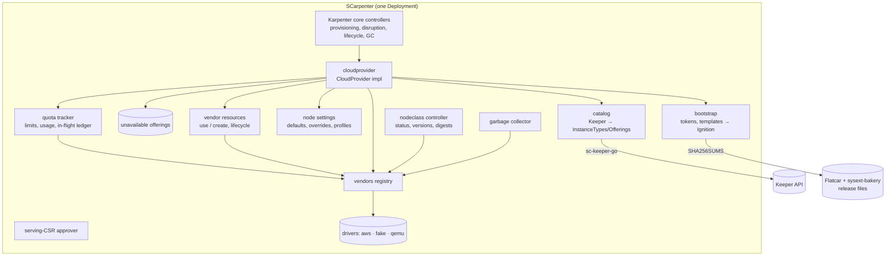

# 00 — v1 overview: architecture, API, catalog, bootstrap, drivers, testing

Status: **draft for review**. This is the base document every later v1 plan
builds on. It fixes what v1 does and how the vendor-neutral core is built, so
that vendor drivers can be added without touching it. AWS is the first
driver; more vendors follow as later plans. Node settings and profiles,
instance selection and vendor resources are designed in detail in
[`00a-node-options.md`](00a-node-options.md) (accepted); this overview
summarises them and 00a decides where it is shorter. Decisions are recorded as
ADRs in [`docs/explanation/DECISIONS.md`](../../../explanation/DECISIONS.md);
open questions and facts still to verify are in §15.

External facts are dated: Karpenter core tags as of 2026-11-05, Flatcar stable
4757.2.3 and sysext-bakery releases as of 2026-11-05, Spare Cores data as of
the snapshot plan 01 commits.

## Table of Contents

- [1. Goal and non-goals](#1-goal-and-non-goals)
- [2. v1 scope](#2-v1-scope)
- [3. Architecture](#3-architecture)
- [4. Karpenter integration](#4-karpenter-integration)
- [5. Catalog: Keeper data to instance types and offerings](#5-catalog-keeper-data-to-instance-types-and-offerings)
- [6. The `SCNodeClass` API](#6-the-scnodeclass-api)
- [7. Driver contract](#7-driver-contract)
- [8. Node bootstrap](#8-node-bootstrap)
- [9. Images](#9-images)
- [10. Garbage collection](#10-garbage-collection)
- [11. The AWS driver](#11-the-aws-driver)
- [12. Configuration](#12-configuration)
- [13. Testing](#13-testing)
- [14. Plan sequence](#14-plan-sequence)
- [15. Open questions and facts to verify](#15-open-questions-and-facts-to-verify)

---

## 1. Goal and non-goals

SCarpenter is a [Karpenter](https://karpenter.sh) cloud provider that can launch
**any instance type at any supported vendor** into **any conformant Kubernetes
cluster**. It builds instance types and priced offerings from the Spare Cores
catalog (the public Keeper API), boots every node from an official
[Flatcar Container Linux](https://www.flatcar.org) image configured by
Ignition, and joins it with plain kubelet TLS bootstrap.

Design principles (ADR-001 to ADR-003):

1. **No extra infrastructure for users.** One Deployment. It depends only on
   the Keeper API and statically published artifacts: Flatcar images and
   release files, Flatcar sysext-bakery releases, SCarpenter's own image and
   chart. No boot server, no image registry service, no callback endpoint. All
   URLs are configurable (self-hosted Keeper, mirrors).
2. **Distribution-agnostic join.** kubelet TLS bootstrap with a per-node
   bootstrap token. Works with k3s, kubeadm, RKE2 or any control plane that
   enables bootstrap-token authentication.
3. **One OS everywhere.** Flatcar from disk images, Ignition in user-data,
   components as systemd sysexts.
4. **Karpenter semantics.** Pending Pods drive provisioning, offerings carry
   real prices, offerings without free vendor quota are unavailable (read
   proactively from vendor APIs where they exist), capacity errors fall back to
   the next offering, and disruption, expiry, consolidation and drift come from
   Karpenter core.
5. **One binary, many vendors.** Vendor drivers are in-tree Go packages behind
   one interface (ADR-004). Adding a vendor never changes the core.

Non-goals for v1: managed-cluster integrations (EKS/GKE/AKS node bootstrap,
cloud-controller-manager features), Windows nodes, non-Flatcar operating
systems, a cloud-controller-manager, load balancer or volume integrations,
spot interruption queues, out-of-process plugins.

## 2. v1 scope

| # | Feature | Notes |
|---|---|---|
| F1 | Karpenter CloudProvider on core **v1.15.x** | `Create`, `Delete`, `Get`, `List`, `GetInstanceTypes`, `IsDrifted`, `RepairPolicies`, `GetSupportedNodeClasses`, `Name`, `DisruptionReasons` (§4) |
| F2 | Keeper catalog | Instance types and per-zone, per-capacity-type priced offerings from Keeper, scoped to what NodeClasses allow, refreshed hourly, stale-while-error (§5) |
| F3 | `SCNodeClass` CRD (`scarpenter.sparecores.com/v1alpha1`) | one NodeClass for many vendors: shared settings (Flatcar and Kubernetes versions, network template, kubelet, networking) plus a typed block per vendor (§6, ADR-014) |
| F4 | Driver contract + registry | `Driver` interface, optional capability interfaces, error classes, conformance suite (§7) |
| F5 | Node bootstrap | Bootstrap tokens, Butane templates → Ignition, sysexts pinned by sha256, `tailscale` and `direct` network templates plus custom templates, client-cert RBAC, serving-CSR approver (§8) |
| F6 | Quota-aware placement + unavailable-offerings cache | Drivers report quota limits, usage and per-zone launchable types from the vendor API; offerings without free quota are unavailable, so nodes go only where the account can launch them, and pinned regions wait for quota (§5.9). Capacity errors (and quota errors on vendors without a quota API) mark offerings unavailable for a TTL (§5.6) |
| F7 | Drift | per-vendor NodeClass hash on NodeClaims (§6.3) |
| F8 | Garbage collection | Orphan instances, bootstrap tokens, managed vendor resources by lifecycle (§10) |
| F9 | AWS driver | Official Flatcar AMIs, EBS root and data volumes, placement groups, dedicated tenancy, ENA Express, VPC/subnets/security groups brought by the user or managed, on-demand and spot, IMDSv2, tag-scoped IAM (§11) |
| F10 | Development drivers | `fake` (KWOK nodes, any catalog) and `qemu` (real Flatcar VMs on the developer's machine), behind a build tag (§13) |
| F11 | Packaging | Multi-arch image, OCI Helm chart, CRDs, RBAC, signed releases (plan 09) |
| F12 | Observability | NodeClass status conditions, Events, Prometheus metrics (catalog age, launches and errors by class, launch-to-Ready latency) |
| F13 | Instance selection | Attribute labels, benchmark metric labels (score, percentile, score per USD) and selection profiles with sc-karpenter-nodepool's selector and ranking, all as label requirements (§5.5, 00a §7, ADR-019) |
| F14 | Node settings and profiles | Vendor-native settings: built-in defaults, NodeClass vendor overrides, named storage/network/placement profiles that workloads pick by label; never a silent degradation (00a §3, §6, ADR-017, ADR-020) |
| F15 | Vendor resources | Every resource a node depends on is brought by the user (IDs, name pattern or tags per region) or created by SCarpenter with a lifecycle (`perUse`, `idleTTL` 24 h, `retain`) (00a §9, ADR-018) |

Further vendor drivers come after AWS as their own plans (15 to 21, listed in
`docs/plans/v1/README.md`), each on the same contract and conformance suite and on
the shared groundwork of plan 14. Where
each vendor's Flatcar image comes from is decided by the image ladder of ADR-021
(§9); SCarpenter imports no images in v1 (rung 4, `SCImage` and `ImageImporter`,
stays reserved).

Deferred (designed for, not built in the plans so far): GPU sysexts (plan 12
is optional and gated on the GPU spike), interruption handling,
Headscale/Tailscale node cleanup through their APIs, per-node tailnet keys, a
NodeClass-level instance-type pre-filter (only if §5.7 measurements need it),
the annotation shorthand for workloads (ADR-016), dedicated hosts, EFA,
attaching existing volumes or snapshots, and changes to the Spare Cores data
(v1 uses what exists, 00a §12).

## 3. Architecture



### 3.1 Module layout

Module path `github.com/SpareCores/scarpenter`. Go 1.26.10 (required by
Karpenter core v1.15.1); k8s libraries v0.36.x and controller-runtime v0.24.1,
exactly core's versions (sc-keeper-go v0.1.2 requires no newer). `coreos/butane`
joins the module with the first code that imports it (plan 05).

```
cmd/controller/main.go          operator wiring (core operator + our controllers)
pkg/apis/v1alpha1/              SCNodeClass types, labels, well-known label registration
pkg/cloudprovider/              CloudProvider implementation (vendor-neutral)
pkg/catalog/                    Keeper → InstanceTypes/Offerings, cache, scoping
pkg/catalog/static/             static catalog source (dev drivers, tests)
pkg/unavailable/                unavailable-offerings cache
pkg/quota/                      quota tracker: refresh, headroom, in-flight ledger, conditions
pkg/catalog/labels/             attribute, metric, selection, location and profile labels
pkg/options/                    option registry, settings resolution (defaults ← vendor block ← profiles)
pkg/resources/                  vendor resources: use/create, adoption, lifecycles, GC
pkg/bootstrap/                  tokens, template rendering, Butane → Ignition, user-data encoding
pkg/bootstrap/templates/        embedded base, tailscale, direct templates, first-boot volume unit
pkg/artifacts/                  Flatcar / sysext URL building and SHA256SUMS resolution
pkg/controllers/nodeclass/      SCNodeClass status: versions, digests, images, readiness
pkg/controllers/csr/            kubelet-serving CSR approver
pkg/controllers/bootstraptoken/ token cleanup after registration
pkg/controllers/garbagecollection/
pkg/vendors/driver.go           Driver interface, capability interfaces, error classes
pkg/vendors/registry.go         registration, enablement from config
pkg/vendors/conformance/        reusable driver conformance test suite
pkg/vendors/aws/                AWS driver
pkg/vendors/fake/               fake driver (build tag scarpenter_dev)
pkg/vendors/qemu/               qemu driver (build tag scarpenter_dev)
pkg/operator/                   config, options, client construction
charts/scarpenter/              Helm chart
config/                         generated CRDs and RBAC (controller-gen)
hack/                           dev container, scripts (ported from sc-karpenter-nodepool)
test/data/sc-snapshot/          committed Keeper responses
test/kwok/                      L3 lane
test/qemu/                      L4 lane
test/e2e-aws/                   L5 lane
```

`pkg/` rather than `internal/`: drivers in other repositories, tests and the
future `sc-karpenter-nodepool` integration may import the API types and the
driver contract.

### 3.2 What we reuse

| Source | What | How |
|---|---|---|
| [`sc-karpenter-nodepool`](https://github.com/SpareCores/sc-karpenter-nodepool/tree/d715fb48935e2f1721eb5c6888ed14755aee916c) | Keeper client (retries, `Retry-After`, `data_version` pinning, region chunking, memoising fetcher), snapshot-replay test server, snapshot fetcher and refresh workflow | Extracted into the shared module [`sc-keeper-go`](https://github.com/SpareCores/sc-keeper-go) by plan 01 (ADR-005); both projects import it |
| `sc-karpenter-nodepool` | Selection engine (candidates from Keeper rows, selectors, ranking, band, data-quality policy) and its `Selector`/`Ranking` API types | Moved into `sc-keeper-go` (package `selection`) by plan 01 and shared (ADR-019) |
| `sc-karpenter-nodepool` | Dev container, `hack/dev.sh`, Makefile targets, golangci config, CI and release workflows, chart skeleton and `chart-sync.sh`, `check-docs.py`, KWOK lane bootstrap, AWS e2e OIDC + sweeper pattern | Copied and adapted (plans 02, 09, 10); same conventions so one person can work on both |
| [Karpenter core](https://github.com/kubernetes-sigs/karpenter) | Operator, all lifecycle/disruption controllers, `cloudprovider` types, scheduling requirements, the KWOK test provider's node-faking approach, `cloudprovider/fake` for unit tests | Imported (`sigs.k8s.io/karpenter`) |
| [karpenter-provider-aws](https://github.com/aws/karpenter-provider-aws/tree/30c236cafacb3a23fb3a50370d09d71750b56b29) | EC2 error-code classification ([`pkg/errors/errors.go`](https://github.com/aws/karpenter-provider-aws/blob/30c236cafacb3a23fb3a50370d09d71750b56b29/pkg/errors/errors.go#L61)), unavailable-offerings TTLs, kube-reserved formula, VM memory overhead default, `main.go` operator wiring | Re-implemented with attribution comments (Apache-2.0 → our MPL-2.0 files; small facts and formulas, not copied files) |
| [karpenter-provider-hetzner](https://github.com/stubbi/karpenter-provider-hetzner/tree/a20777acb552216996db0fe6ccd1e7216aa59b2c) | Structure of a bootstrap-agnostic provider (NodeClass controller, instance provider, operator) | Reference only |
| [`coreos/butane`](https://github.com/coreos/butane) | Butane → Ignition translation (`flatcar` variant) | Imported as a Go library |
| [`sc-inspector`](https://github.com/SpareCores/sc-inspector/blob/c583123c85b44c65bbf6fa0ec0b67418469e4abf/inspector/lib.py#L92-L138), [`sc-runner`](https://github.com/SpareCores/sc-runner/blob/0c210d3f6118823f9d64d148af3824621ce473a6/src/sc_runner/resources/aws.py) | Known retryable start errors, per-vendor defaults (disk, spot, public IP) | Facts ported into driver error maps and defaults |

## 4. Karpenter integration

SCarpenter imports Karpenter core and runs core's operator with its own
`CloudProvider`, like every other provider (wiring pattern: the AWS provider's
[`cmd/controller/main.go`](https://github.com/aws/karpenter-provider-aws/blob/30c236cafacb3a23fb3a50370d09d71750b56b29/cmd/controller/main.go#L32)).
Core version: **v1.15.x** (latest minor on 2026-11-05; v1.15.1 =
`8fb3abde2be3111cd26e0c0f45ac0babdeb8e9c0`). Policy: follow core minors within
about a month; the L3 lane runs against the pinned core.

| Method | Behaviour |
|---|---|
| `Name()` | `scarpenter` |
| `GetSupportedNodeClasses()` | `SCNodeClass` |
| `GetInstanceTypes(nodePool)` | Resolve the NodePool's `SCNodeClass`; return the catalog's instance types for the vendors the NodePool allows and the NodeClass configures, in their allowed regions, pre-filtered by the NodePool's `In`/`NotIn` requirements on vendor, region, zone, arch, capacity type and instance type (safe: core would drop them anyway). Offerings are dropped where the driver reports the type as not launchable (§5.9), and marked unavailable when a quota bucket they consume has no headroom (§5.9), from the unavailable-offerings cache, for zones the driver cannot use (§7.1 `Zones`), and for regions without a ready image. A vendor that is not ready in the NodeClass yields no instance types. When the NodePool pins one selection profile with a non-`Price` objective, offerings are priced by that objective (00a §7.3). |
| `Create(nodeClaim)` | See §4.1. |
| `Delete(nodeClaim)` | Driver `DeleteInstance` by the instance reference (annotation, else tag lookup). NotFound = `NodeClaimNotFoundError` (core treats it as done). Deletes the NodeClaim's bootstrap token. |
| `Get(providerID)` | Parse `scarpenter://<vendor>/<region>/<nodeclaim>`; look up through the List cache, on a miss ask the driver (`GetInstance` by tag). Terminated or terminating instances are NotFound. |
| `List()` | Driver `ListInstances` with the cluster tag, per vendor, over the regions that any NodeClass allows or any NodeClaim uses. Cached for 30 s. |
| `IsDrifted(nodeClaim)` | `NodeClassDrift` when the NodeClaim's `scarpenter.sparecores.com/nodeclass-hash` annotation differs from the NodeClass's current hash for the NodeClaim's vendor (§6.3); `""` otherwise. |
| `RepairPolicies()` | `Ready=False` and `Ready=Unknown` for 10 minutes. Users who do not want repair disable core's node repair feature gate. |
| `DisruptionReasons()` | none beyond core's |

### 4.1 `Create`

1. Resolve the `SCNodeClass`; if it, or the vendor's part of it, is not ready,
   return `NodeClassNotReadyError`. Resolve the vendor settings from the
   NodeClaim's requirements: built-in defaults ← NodeClass vendor block ← the
   selected storage, network and placement profiles (00a §3).
2. Compute the candidate offerings: instance types from the NodeClaim's
   requirements (core passes the compatible set), crossed with their available
   offerings that satisfy the NodeClaim's zone, region and capacity-type
   requirements and the resource requests. Sort by price plus the settings'
   price delta (disks, public IPv4; 00a §10), or by the selected selection
   profile's objective (00a §7.3); ties are broken by
   the larger quota headroom (§5.9), then instance-type name, then zone, for
   determinism. Spot and on-demand are not special-cased: price decides.
3. Mint a bootstrap token (§8.1) and render the user-data for the chosen
   instance type's architecture and region (§8.2). User-data depends on the
   architecture (sysext URLs), not on the instance type, so one rendering
   serves every attempt with the same arch. Before the first vendor call, run
   the driver's `Prepare` for resources the instance needs first (vendor
   resources with `create`, placement groups, separate volumes; 00a §9), and
   render their device hints into the user-data (00a §11).
4. Walk the candidates in price order. Skip, without calling the vendor and
   without counting an attempt, every candidate whose quota buckets lack
   headroom once the in-flight reservations of concurrent launches are taken
   into account (§5.9); for the first one with headroom, reserve its
   consumption and call `driver.CreateInstance`. On an error of class
   `InsufficientCapacity` or `QuotaExceeded`, release the reservation, record
   the error (unavailable-offerings cache; for `QuotaExceeded` also an
   immediate quota refresh of that region) and continue, up to
   `--max-launch-attempts` (default 3) vendor calls. `Retryable` errors are
   returned as-is (core retries the NodeClaim). `Fatal` errors return a
   `CreateError` and set a NodeClass Event.
5. If no candidate has headroom or every attempt fails with capacity or
   quota, return `InsufficientCapacityError`: core deletes the NodeClaim and
   the next scheduling round sees the offerings as unavailable. With no
   candidates because the catalog is not ready (a restarted controller without a
   first snapshot), return a retryable `CreateError` (`CatalogNotReady`) instead:
   core would otherwise delete a NodeClaim whose instance a replayed idempotency
   key finds (found by the L4 restart scenario, plan 07).
6. Return the NodeClaim with `providerID`, capacity and allocatable of the
   chosen type, labels (§5.5) for the chosen offering and the applied
   profiles (or `default`), and annotations:
   `scarpenter.sparecores.com/instance-ref` (driver-opaque reference, e.g.
   `us-east-1/i-0abc…`), `scarpenter.sparecores.com/nodeclass-hash`,
   `scarpenter.sparecores.com/price` (hourly price at launch, USD), and
   `scarpenter.sparecores.com/price-incomplete: "true"` when the price misses
   components the data does not have (allowed by default).

Idempotency: the NodeClaim UID is passed to the driver as an idempotency key
(AWS `ClientToken`), so a crash between the vendor call and the status update
does not launch a second instance.

### 4.2 Provider ID and instance identity (ADR-007)

`providerID = scarpenter://<vendor>/<region>/<nodeclaim-name>`. It is known
before the instance exists, so it is rendered into the kubelet configuration
without any vendor metadata service, for every vendor alike. The vendor's own
instance ID lives in the `instance-ref` annotation and in vendor tags
(`nodeclaim=<name>`), which also serve as the fallback lookup. Node name =
NodeClaim name (`--hostname-override`).

## 5. Catalog: Keeper data to instance types and offerings

### 5.1 Keeper queries

Through `sc-keeper-go` (plan 01), per refresh cycle:

| Endpoint | Used for |
|---|---|
| `GET /healthcheck` | `database_hash`, sent as `data_version` on every cacheable request (one consistent data version per refresh) |
| `GET /table/server` | Specs of every server: vendor, `api_reference`, family, vCPUs, memory, CPU architecture/manufacturer/family, accelerators, status |
| `GET /server_prices?vendor=<v>&vendor_regions=<v>~<r>…&currency=USD&limit=-1` | Offerings: (server, region, zone, allocation, price). Anonymous. Rows embed full nested server/vendor/region/zone objects and the response is not compressed (about 4 KB per row: 137 MB for four AWS regions, 2026-11-05), so the client decodes it streaming into flat rows and SCarpenter fetches only the regions in scope |
| `GET /table/server_prices?…` | The same offerings as flat rows, used instead when a Keeper API key is configured (it answers 401 without one) |
| `GET /table/zone`, `GET /table/region` | Zone ↔ region mapping, zone IDs and names, region status |

Only vendors with at least one `SCNodeClass`, and only the regions those
NodeClasses allow (all active regions if a NodeClass lists none), are fetched.
Servers with a status other than `active` (and `planned for retirement`) are
dropped, as are servers without a price in scope.

Measured in plan 01 (2026-11-05): `/table/server` is 6,113 rows, 12 MB of
JSON; `/table/*` and `/server_prices` are cached by the CDN (`max-age` 3600 and
900 s). Because `/server_prices` is large, a NodeClass's region allow-list
directly bounds the refresh cost; enabling compression at Keeper's CDN would
cut the transfer by an order of magnitude.

### 5.2 Refresh and staleness

- Refresh every `--catalog-refresh-interval` (default 1 h) with ±10 % jitter,
  and immediately when a NodeClass changes the vendor/region scope.
- Stale-while-error: on failure keep the last good snapshot and set
  `CatalogReady=False` with the error on affected NodeClasses only once the
  snapshot is older than `--catalog-max-age` (default 24 h); until then a
  warning Event and a metric suffice.
- Without any snapshot (cold start, Keeper down), NodeClasses stay
  `CatalogReady=False` and `GetInstanceTypes` returns nothing for them: pods
  stay pending with a clear reason instead of nodes being launched blind.
- Optional API key (`--keeper-api-key-file`) for higher rate limits.
- Prices come only from Keeper, spot prices included: Keeper keeps its spot
  price database continuously updated, so drivers never query vendor price
  APIs (no `DescribeSpotPriceHistory`). The catalog refresh interval bounds
  how stale a spot price can be.

### 5.3 Instance types

One Karpenter `InstanceType` per (vendor, `api_reference`):

- **Name**: `<vendor>.<api_reference>`, e.g. `aws.m7i.large` (ADR-008).
  Characters outside the label-value charset become `-`; names longer than 63
  characters are truncated to 56 and suffixed with `-` + 6 hex chars of the
  SHA-256 of the full name. The raw `api_reference` is the
  `scarpenter.sparecores.com/api-reference` label (or, if it does not fit, only
  an annotation).
- **Capacity**: `cpu` = vCPUs; `memory` = Keeper memory (MiB) × (1 −
  `vmMemoryOverheadPercent`, default 7.5 %, as in the AWS provider, settable
  per NodeClass); `pods` = the NodeClass `kubelet.maxPods` (default 110);
  `ephemeral-storage` = the root disk size of the vendor's resolved default
  settings (a storage profile with a larger root disk does not change what the
  scheduler assumes). No GPU extended
  resources in v1: without a device plugin they would never appear on the
  node and pods requesting them would loop (GPU types are selectable by label).
- **Overhead**: `kubeReserved` from the AWS provider's CPU/memory formula
  (cited in code), `systemReserved` and eviction thresholds from the NodeClass
  kubelet settings, defaults documented in the reference.
- **Requirements**: the per-type labels of §5.5, including the attribute,
  metric, selection and profile labels (defined on every type, `DoesNotExist`
  where a value is unknown or nothing applies).

### 5.4 Offerings

One `Offering` per (instance type, zone, capacity type) with a price in scope:
`Price` = hourly USD price plus the default settings' price delta (or the
pinned selection objective), `Requirements` = zone, region, capacity type,
location labels and per-offering metric labels (`metric-<m>-per-usd`),
`Available` = not in the unavailable-offerings cache, zone usable by the driver
(§7.3), region has a ready image.

Allocations map `ondemand` → `on-demand`, `spot` → `spot`. Vendors without
zones in Keeper get zone = region. Where Keeper has only a region-level
on-demand price (no zone), the offering is replicated into every zone the
driver reports for that region.

### 5.5 Labels

Registered as well-known labels with core (so NodePools may use them and the
scheduler treats them as known):

| Label | Example | Notes |
|---|---|---|
| `node.kubernetes.io/instance-type` | `aws.m7i.large` | §5.3 |
| `topology.kubernetes.io/region` | `us-east-1` | vendor region ID |
| `topology.kubernetes.io/zone` | `us-east-1a` | the zone **name as the driver's account sees it** (§5.8) |
| `karpenter.sh/capacity-type` | `on-demand`, `spot` | |
| `kubernetes.io/arch`, `kubernetes.io/os` | `amd64`, `linux` | |
| `scarpenter.sparecores.com/vendor` | `aws` | |
| `scarpenter.sparecores.com/api-reference` | `m7i.large` | |
| `scarpenter.sparecores.com/family` | `m7i` | Keeper `family` |
| `scarpenter.sparecores.com/zone-id` | `use1-az1` | Keeper zone ID; portable across accounts |
| `scarpenter.sparecores.com/cpu-manufacturer`, `cpu-family` | `Intel`, `Xeon` | |
| `scarpenter.sparecores.com/accelerator-count`, `-manufacturer`, `-model` | `1`, `NVIDIA`, `A10G` | `DoesNotExist` without accelerators |
| attribute labels: `vcpus`, `cpu-cores`, `memory-mib`, `cpu-clock-mhz`, `cpu-l3-mib`, `hyperthreading`, `cpu-flag-<flag>`, `network-baseline-mbps`, `local-storage-gb`, … | `8` | integers or enums from Keeper, for range selection (`Gt`/`Lt`); full list in 00a §7.1 |
| `scarpenter.sparecores.com/metric-<m>`, `metric-<m>-pct` | `2150`, `93` | NodeClass-defined benchmark metrics: score and percentile across the NodeClass's vendors (00a §7.2) |
| `scarpenter.sparecores.com/metric-<m>-per-usd` | `5400` | on offerings: score per USD/hour |
| `scarpenter.sparecores.com/selection` | `fast-single-core` | membership in NodeClass selection profiles (00a §7.3) |
| `scarpenter.sparecores.com/storage-profile`, `network-profile`, `placement-profile` | `db-io2`, `default` | profiles valid for the type (00a §6); stamped on nodes as applied |
| `scarpenter.sparecores.com/placement-group` | `pg-bench-1` | placement run key; free-form, undefined on types (00a §6.3) |
| `scarpenter.sparecores.com/country`, `continent`, `city`, `state`, `green-energy` | `de`, `europe` | on offerings, from Keeper's region and country tables (00a §6.4) |

Every selectable key is defined on every instance type (`DoesNotExist` where
unknown or not applicable): an undefined key would match every type (00a §2).
Labels are stamped on the NodeClaim; Karpenter core copies them to the Node
after registration. The kubelet itself sets only `--provider-id` and the
`karpenter.sh/unregistered:NoExecute` registration taint, so the
NodeRestriction admission plugin never sees a label the kubelet may not set.

### 5.6 Unavailable offerings

| Error class | Key | Default TTL |
|---|---|---|
| `InsufficientCapacity` | (vendor, instance type, zone, capacity type) | 3 min |
| `Unsupported` (type not offered in that zone) | (vendor, instance type, zone) | 24 h |
| `QuotaExceeded`, vendor **without** a quota API | (vendor, region, capacity type) | 30 min |
| `QuotaExceeded`, vendor **with** a quota API | not cached here: triggers an immediate quota refresh; the tracker's view decides (§5.9) | — |
| `ZoneUnusable` (no subnet, no free addresses) | (vendor, zone) | 10 min |

A change of the cache or of the quota tracker's view bumps a sequence number
that `GetInstanceTypes` uses as part of its cache key, so the next scheduling
round sees it.

### 5.7 Scale

Keeper lists about a thousand AWS server types; across all regions, zones and
two capacity types that is in the order of 10⁵ offerings. Mitigations:
scope by NodeClass regions; pre-filter in `GetInstanceTypes` (§4);
recommend one NodePool per vendor and a region allow-list. Plan 04 measures
scheduling latency and memory with the full AWS catalog in the L3 lane (50
pending pods with exact-type selectors, one NodePool, all AWS regions vs.
three). If it is too slow, a NodeClass-level `instanceTypes` filter is added
(post-v1 unless needed).

### 5.8 Zone identity

Keeper stores AWS zones with the portable `ZoneId` (`use1-az1`) as `zone_id`
and the crawler account's `ZoneName` as `api_reference`. Zone names are
account-specific on AWS, so the driver maps Keeper zone IDs to the zone names
of **its own** account (`DescribeAvailabilityZones`) and drops zones the
account does not have (or has not opted in to). `topology.kubernetes.io/zone`
carries the account's name, `scarpenter.sparecores.com/zone-id` the ID. Drivers
for vendors with global zone names return the identity mapping.

### 5.9 Quota-aware placement (ADR-013)

Trying an offering and falling back on a quota error wastes launches, keeps a
region looking usable until something fails there, and cannot tell "no quota
right now" from "no quota ever". Where the vendor API exposes quotas,
SCarpenter reads them proactively and offers only what the account can
launch. (This generalises what sc-inspector does for Azure before a start:
read the regional `cores` and per-family vCPU usage and limit from the Compute
`usages` API, check SKU restrictions, and prefer regions with headroom —
[`azure_dbaas_quota.py`](https://github.com/SpareCores/sc-inspector/blob/c583123c85b44c65bbf6fa0ec0b67418469e4abf/inspector/azure_dbaas_quota.py#L192-L247).)

**Model.** A driver with the `QuotaReporter` capability (§7.1) reports, per
region and, where the vendor has account-wide quotas, globally, a set of
**buckets** `{id, scope: region|global, unit: vCPU|instances|GPUs|GiB, limit,
used}`, and for every (instance type, capacity type) the buckets it consumes
and how much. Examples: AWS `m7i.4xlarge` on-demand consumes 16 vCPU of
"Running On-Demand Standard instances" in its region; Azure
`Standard_D4s_v5` consumes 4 of `cores` and 4 of `standardDSv5Family`; GCP
`n2-standard-8` consumes 8 `CPUS` and 8 `N2_CPUS` in the region and 8
`CPUS_ALL_REGIONS` globally. A type whose consumption the driver cannot map
has **unknown** quota and falls back to the reactive path (§5.6).

A driver with the `OfferingLister` capability also reports which instance
types the account can launch in which zones (AWS
`DescribeInstanceTypeOfferings`, Azure Resource SKU restrictions, GCP machine
types per zone). Types not launchable in a zone are removed from its
offerings instead of being discovered by failed launches. Refreshed hourly.

**Tracker** (`pkg/quota`):

- Refreshes usage per (vendor, region in scope) every
  `--quota-refresh-interval` (default 2 min, ±10 % jitter) and limits every
  15 min; immediately (debounced 10 s) after a `QuotaExceeded` error and after
  SCarpenter launched or terminated an instance in that region. Usage counts
  **everything in the account**, not just SCarpenter's instances: other
  workloads use the same quota.
- In-flight ledger: `Create` reserves an offering's consumption before the
  vendor call (§4.1). A reservation is released when the launch fails, when a
  refresh reports the instance as counted in `used` (drivers return the refs
  they counted), or after 10 minutes. Headroom = limit − used − reserved.
  This keeps several NodeClaims of one scheduling round from planning onto the
  same last few vCPUs.
- Staleness: if a refresh fails, the last values are kept for 15 minutes;
  after that the region's quotas count as unknown (reactive path) rather than
  blocking provisioning on stale data.
- Observability: metrics `scarpenter_quota_limit`, `_used`, `_reserved` per
  (vendor, region, bucket); refresh errors and age.

**Placement.**

- `GetInstanceTypes`: an offering is **unavailable** when any bucket it
  consumes has less headroom than one instance needs. Karpenter's scheduler
  therefore only plans nodes where the account has quota: a NodePool or pod
  that allows several regions gets nodes only in regions (and capacity types)
  with headroom, and price decides among those.
- `Create`: re-checks headroom with the ledger and skips candidates without
  it before calling the vendor (§4.1 step 4).
- **Pinned region.** When the requirements leave exactly one region (the
  NodePool, the NodeClass `regions`, or the pods' selectors/affinity on region
  or zone) and its buckets have no headroom, no offering is available: the
  pods stay Pending and **nothing is launched**. That is Karpenter's normal
  behaviour for pods without a compatible offering, so waiting needs no extra
  machinery. When a refresh shows headroom (instances ended elsewhere in the
  account, a quota increase was granted), the offerings become available and
  the next scheduling round provisions. SCarpenter makes the wait visible: the
  NodeClass condition `QuotaAvailable=False` lists each (region, capacity type,
  bucket, used/limit) where every allowed offering is blocked, with reason
  `QuotaExhausted`, or `QuotaZero` when the limit itself is 0 (it will not
  resolve without a quota increase request); plus a rate-limited Event.
- Among offerings with headroom, price alone orders (headroom breaks ties).
  Keeping headroom free for large types (sc-inspector's reason for starting
  instances in hash order rather than price order) is a post-v1 policy.

**Capacity is not quota.** A launch can still fail with insufficient capacity
when quota is free; that stays reactive (§5.6). Vendor capacity signals such
as AWS Spot placement scores or Alibaba's stock status are post-v1 inputs for
ordering.

Quota APIs per vendor (AWS is planned in detail; the others are research notes for their
future drivers, to be verified there):

| Vendor | Quota source | Buckets | Launchable types |
|---|---|---|---|
| aws | Service Quotas `GetServiceQuota` (limits) + usage computed from `DescribeInstances` and `DescribeSpotInstanceRequests` (§11.8) | vCPU per quota class, on-demand and spot separately | `DescribeInstanceTypeOfferings` by zone ID |
| azure | Compute `usages` per location (current value and limit), as sc-inspector does | `cores` (total regional vCPU), per-family vCPU, `lowPriorityCores` (spot) | Resource SKUs `restrictions` (subscription, zone) |
| gcp | `regions.get` quotas (limit and usage), project quotas | `CPUS`, per-family `*_CPUS`, `PREEMPTIBLE_CPUS`, GPU quotas, `CPUS_ALL_REGIONS` (global) | machine types per zone |
| alicloud | ECS account attributes (vCPU limits and usage) | vCPU on-demand and spot per region | `DescribeAvailableResource` (also stock) |
| upcloud | account resource limits + own usage | cores, memory, GPUs | — |
| ovh | OpenStack quota sets with usage | cores, instances, RAM | — |
| hcloud, vultr | none known | reactive only | — |

## 6. The `SCNodeClass` API

Cluster-scoped, `scarpenter.sparecores.com/v1alpha1`. One NodeClass holds the
shared node definition and a typed block per vendor (ADR-014); NodePools pick
vendors with a `scarpenter.sparecores.com/vendor` requirement (one NodePool per
vendor recommended, for per-vendor limits and budgets). Detailed design and
the meaning of every option: [00a](00a-node-options.md) §4–§9.

```yaml
apiVersion: scarpenter.sparecores.com/v1alpha1
kind: SCNodeClass
metadata: {name: default}
spec:
  flatcar:
    channel: stable                   # stable | beta | alpha | lts
    version: "4757.2.3"               # required, pinned; changing it drifts nodes
  kubernetes:
    version: "v1.37.1"                # required; a sysext-bakery kubernetes release
  network:                            # node bootstrap network template (§8.3)
    template: tailscale               # tailscale | direct | custom
    tailscale:
      version: "v1.98.10"
      loginServer: ""                 # "" = Tailscale SaaS; set for Headscale
      authKeySecretRef: {name: ts-node-key, namespace: scarpenter, key: authkey}
      tags: [tag:k8s-node]
  networking:                         # generic, identical meaning everywhere (00a §6.2)
    publicIPv4: true
    publicIPv6: false
    inbound: {rules: []}              # CIDR rules; empty = deny all
    isolation: run                    # none | nodeclass | run
  kubelet:
    maxPods: 110
    systemReserved: {cpu: 100m, memory: 100Mi}
    evictionHard: {memory.available: 100Mi}
    vmMemoryOverheadPercent: 7.5
  butane: {configMapRef: {name: extras, namespace: scarpenter, key: config.bu}}   # optional
  sysexts: []                         # optional extra sysexts (URL + sha256 + arch)
  poweroffAfter: 24h                  # optional fail-safe
  tags: {owner: example}              # extra vendor tags/labels on every resource
  pricing: {allowIncomplete: true}    # default true (00a §10)
  catalog:
    cpuFlagLabels: [avx2, avx512f, amx_tile, sha_ni]
  metrics:                            # benchmark metric labels (00a §7.2)
    single-core: {benchmark: {id: "geekbench:score", config: {cores: single}}}
  selections:                         # sc-karpenter-nodepool selector + ranking (00a §7.3)
    fast-single-core:
      selector: {vcpus: {min: 2}}
      ranking: {score: {benchmark: {id: "geekbench:score", config: {cores: single}}}, objective: Score, band: {withinPercent: 12}, families: {min: 3}}
  profiles:                           # explicit, vendor-native; workloads pick them by name (00a §6)
    storage:
      db-io2:
        aws: {root: {volumeType: gp3, volumeSize: 64Gi}, data: [{name: pgdata, volumeType: io2, volumeSize: 500Gi, iops: 32000, filesystem: xfs, mountPath: /var/lib/pgdata}]}
    placement:
      colocated: {aws: {placementGroup: {strategy: cluster}}}
      dedicated: {aws: {tenancy: dedicated}}
    network:
      ena-express: {aws: {enaExpress: {enabled: true}}}
  vendors:
    aws:
      regions: [us-east-1, us-east-2] # optional allow-list; empty = every active region the driver can use
      storage: {root: {volumeType: gp3, volumeSize: 128Gi}}   # overrides the built-in AWS defaults
      networking: {}                  # per-vendor overrides of spec.networking
      metadataOptions: {httpTokens: required, httpPutResponseHopLimit: 1}
      instanceProfile: ""             # none by default: nodes hold no cloud credentials
      imageOwner: ""                  # "" = the official Flatcar account
      resources:                      # use (bring your own) or create (managed), per kind (00a §9)
        subnets: {use: {tags: {scarpenter.sparecores.com/use: "true"}}}
        securityGroups: {create: {lifecycle: {policy: idleTTL, ttl: 24h}}}
        placementGroups: {create: {lifecycle: {policy: perUse}}}
status:
  conditions: [Ready, CatalogReady, ArtifactsReady, ValidationSucceeded]   # RestartRequired when set
  resolved:
    kubernetes: {amd64: {url: …, sha256: …}, arm64: {…}}
    tailscale:  {amd64: {…}, arm64: {…}}
  vendors:
    aws:
      conditions: [VendorReady, ImagesReady, ResourcesReady, QuotaAvailable]
      hash: "…"                       # per-vendor drift hash, §6.3
      images: [{region: us-east-1, arch: amd64, ref: ami-…, ready: true}]
      resources: [{kind: securityGroups, region: us-east-1, id: sg-…, managed: true, lastUsed: "…"}]
      quota: [{region: us-east-1, capacityType: on-demand, bucket: L-1216C47A, used: 64, limit: 64, reason: QuotaExhausted}]
```

### 6.1 Validation

CEL rules in the CRD: `network.tailscale` required iff `template: tailscale`,
`network.custom` iff `custom`; versions match their patterns; each resource
kind has at most one of `use` and `create`. Vendor blocks and profile blocks
are typed per vendor (one Go struct per driver, schema generated per vendor
key). Semantic checks run in the NodeClass controller and surface as
conditions: the vendor is enabled, regions exist, the driver's
`ValidateNodeClass` accepts its blocks (e.g. against Keeper's storage size and
IOPS limits), metrics resolve to known benchmark configs, the Kubernetes
version is within the supported skew of the API server (kubelet at most three
minors older and never newer). They are the Ready dependent
`ValidationSucceeded` (kubelet quantities, the skew, the referenced ConfigMaps
and Secret, and a trial rendering of the user-data for both architectures within
the size budget, with the real cluster CA). Boot images come from the driver's
optional `ImageReporter` capability (`ImagesReady`, informational; a driver
without it resolves images at launch and counts as ready).

### 6.2 Status and readiness

The NodeClass controller resolves artifacts (sysext URLs and their sha256 from
the release's `SHA256SUMS`, §8.4) for the whole NodeClass, and per vendor:
readiness (credentials, regions, validation), images per region and arch (§9),
referenced and managed resources per region (00a §9) and quota (§5.9). The
NodeClass is `Ready` when the shared parts are (`CatalogReady`, `ArtifactsReady`, `ValidationSucceeded`); a vendor that is not ready
only makes its own offerings unavailable. Images and resources resolve lazily
per region; a region whose image or required resource is not ready has
unavailable offerings with a stated reason, not a non-ready NodeClass.
`QuotaAvailable=False` is informational (§5.9).

### 6.3 Drift

Per vendor: `status.vendors.<v>.hash` = SHA-256 over the canonical JSON of the
shared fields that change what a node is (`flatcar`, `kubernetes`, `network`
including the custom template content and the auth key Secret's
resourceVersion — not the key itself, `networking`, `kubelet`, `butane`
content, `sysexts`, `poweroffAfter`, `tags`), that vendor's block (without
`regions` and `resources`), the resolved artifact digests (not their URLs, so a
mirror switch drifts nothing), plus a `hashVersion` constant bumped when the
rendering changes in a node-affecting way. A NodeClaim is drifted when its
vendor's hash changes, or when a profile it uses changes its block for that
vendor (profile hashes are compared separately, so changing one profile
drifts only the nodes that use it). Changing another vendor's block never
drifts a node. Not included: regions (core's requirement drift covers them),
resource references (they affect new launches only), metrics and selections
(they change labels, not nodes). An input that cannot be loaded for a moment
(a missing or unreadable reference, a failing skew check, a release server
outage) keeps the previous hash: a transient failure never drifts the nodes.

## 7. Driver contract

### 7.1 Interface (ADR-004)

```go
// Driver is implemented by every vendor package and registered by name.
type Driver interface {
    Vendor() string                       // "aws"; the Keeper vendor ID
    Init(ctx context.Context, cfg Config) error
    Regions(ctx context.Context) ([]Region, error)            // regions the credentials can use
    Zones(ctx context.Context, region string) ([]Zone, error)  // account zones, with Keeper zone IDs
    ResolveImage(ctx context.Context, req ImageRequest) (*Image, error) // official images
    CreateInstance(ctx context.Context, req CreateRequest) (*Instance, error)
    GetInstance(ctx context.Context, ref InstanceRef) (*Instance, error)
    FindInstance(ctx context.Context, region string, tags map[TagKey]string) (*Instance, error)
    ListInstances(ctx context.Context, regions []string, tags map[TagKey]string) ([]*Instance, error)
    DeleteInstance(ctx context.Context, ref InstanceRef) error
    TagKey(k TagKey) string               // maps logical keys to the vendor charset
}

// Optional capabilities, discovered with type assertions.
type NodeClassValidator interface { ValidateNodeClass(ctx, *v1alpha1.SCNodeClass) error }
type NodeOptions       interface { Defaults() VendorSettings                                  // built-in defaults (00a §5.3)
                                   Supported(it CatalogType, zone string, p Profiles) map[string][]string // valid profiles per type
                                   PriceDelta(s VendorSettings, o Offering) (float64, bool)        // usd/h, complete
                                   Prepare(ctx, PrepareRequest) (*Prepared, error) }               // pre-instance resources, device hints
type ManagedResources  interface { Kinds() []ResourceKind                                         // kinds, default policy, dependencies
                                   Resolve(ctx, kind, region string, ref UseRef) ([]ResourceRef, error)  // `use`: IDs, name pattern, tags
                                   Ensure(ctx, kind, region string, spec CreateSpec) (ResourceRef, error) // `create`: find-or-create, idempotent
                                   InUse(ctx, ResourceRef) (bool, time.Time, error)
                                   Delete(ctx, ResourceRef) error
                                   List(ctx, tags map[TagKey]string) ([]ResourceRef, error) }     // for adoption and GC
type QuotaReporter     interface { Quotas(ctx, region string) (*QuotaSnapshot, error)   // buckets: limit, used, counted refs
                                   GlobalQuotas(ctx) (*QuotaSnapshot, error)               // account-wide buckets; may be empty
                                   Consumption(instanceType, capacityType string) ([]Consumption, bool) } // false = unknown
type OfferingLister    interface { LaunchableTypes(ctx, region string) (map[string][]string, error) } // type → zone IDs
type ImageImporter     interface { ImportImage(…); DeleteImage(…); ListImages(…) } // reserved: rung 4 of ADR-021, not built in v1
```

`CreateRequest` carries: region, zone (account name), instance type
(`api_reference`), capacity type, image, user-data bytes, the resolved vendor
settings (defaults ← vendor block ← profiles, decoded by the driver), the
prepared resources (resolved or ensured resource refs, placement group,
pre-created volumes), logical tags and the idempotency key. `Instance` carries: ref, region, zone, type, capacity type,
state (`pending|running|terminating|terminated`), creation time, tags,
addresses.

Logical tag keys: `cluster`, `nodeclaim`, `nodepool`, `nodeclass`, `managed-by`,
`idempotency-key`. AWS maps them to `scarpenter.sparecores.com/<key>`; vendors with
restrictive label charsets (e.g. GCP) to `scarpenter-<key>`. `idempotency-key` holds the
NodeClaim UID on vendors with neither a create token nor a deterministic name: it is
looked up before every create and written by the driver (`vendors.IdempotencyTag`);
AWS has the client token and does not write it.

### 7.2 Error classes

Drivers wrap every vendor error into one of: `InsufficientCapacity`,
`Unsupported`, `QuotaExceeded`, `ZoneUnusable`, `Retryable`, `NotFound`,
`Fatal`. Classification matches **SDK error codes**, never message text, except
where a vendor only provides text (the `qemu` driver, and vendors whose API has no
error codes). Message-based classification has four conditions: the driver documents
each text, a table-driven test pins every text, the HTTP status is captured per
request (a text alone never decides), and a text that matches nothing is `Fatal`,
never `InsufficientCapacity` (ADR-013). `qemu` predates the rule and keeps its own
documented fallback (an unmatched failure to start the VM is `Retryable`). The class
table and the codes per vendor are reference documentation. A `QuotaExceeded` of a
vendor with account-wide limits carries `AccountWide`, which gates the capacity type in
every region of the vendor for the quota TTL.

Quota and capacity classes stay distinct even when a vendor reports both
with one error code: the driver decides from the code and payload whether a
region-wide limit (`QuotaExceeded`) or the zone's stock
(`InsufficientCapacity`) failed, because they are cached and refreshed
differently (§5.6, §5.9).

### 7.3 Registry

Each driver package registers itself in `init()`; `cmd/controller` imports the
production drivers, and the dev drivers only with the `scarpenter_dev` build
tag. A driver runs only if enabled in the configuration (`--vendors=aws` /
Helm `vendors.aws.enabled`); a NodeClass for a disabled vendor is
`VendorReady=False`.

### 7.4 Conformance suite

`pkg/vendors/conformance` is a Go test suite every driver runs against its
in-process fake (and, opt-in, against the real vendor): idempotent create with
the same key, NotFound semantics, list by tags, delete idempotency, error
classification table, tag round-trip, zone mapping, user-data size limit, and
for drivers with `QuotaReporter`: every instance type of the vendor's
snapshot catalog maps to buckets or is on an explicit "unknown" list, launches
show up in `used` with their refs, and a quota error is classified as
`QuotaExceeded`, not `InsufficientCapacity`. For `NodeOptions` and
`ManagedResources`: every profile block is either valid or explicitly
unsupported for every catalog type; `Prepare` and `Ensure` are idempotent;
`use` resources are never modified; managed resources are found again after a
restart (adoption) and deleted in dependency order. Plan 14 adds: a malformed
instance reference is `NotFound`, never `Fatal`; the idempotency label round-trips for
drivers that store it; a powered-off instance (fixture hook) reports `terminating`,
stays listed and deletes cleanly; an account-wide quota error gates every region
exactly when the fixture says the vendor's limits are account-wide.
Adding a vendor = implement the interface + pass the suite.

## 8. Node bootstrap

### 8.1 Bootstrap tokens

Per NodeClaim, `Create` writes a `bootstrap.kubernetes.io/token` Secret in
`kube-system`: `token-id` (6 chars `[a-z0-9]`), `token-secret` (16 chars),
`expiration` now + `--bootstrap-token-ttl` (default 1 h),
`usage-bootstrap-authentication: "true"`,
`auth-extra-groups: system:bootstrappers:scarpenter`, label
`scarpenter.sparecores.com/nodeclaim=<name>`. The `bootstraptoken` controller
deletes it when the NodeClaim is `Registered` or gone; core's `tokencleaner`
removes expired ones as a backstop.

Cluster prerequisites (documented, checked where possible): bootstrap-token
authentication enabled on the API server, the `tokencleaner` controller, a CNI
and kube-proxy (or replacement) that run on remote nodes as DaemonSets.

### 8.2 Rendering

User-data is a small Ignition config whose `ignition.config.merge` list holds
`data:` URLs (gzip + base64, `compression: gzip`) of three separately
translated configs:

1. **base** (always): bootstrap kubeconfig (API endpoint, token, and a reference to the cluster CA file it also writes),
   kubelet configuration file and a kubelet unit drop-in
   (`--bootstrap-kubeconfig`, `--kubeconfig`, `--config`, `--provider-id`,
   `--hostname-override`, `--register-with-taints`, `--node-ip` from the
   network template), `/etc/hostname`, the `kubernetes` sysext (URL + sha256,
   enabled via systemd-sysext), masked `update-engine` and `locksmithd`, an
   optional poweroff timer (`OnBootSec=poweroffAfter`, `systemctl poweroff
   --force`; on AWS shutdown behaviour is `terminate`).
2. **network** (`tailscale` | `direct` | `custom`).
3. **user** (`spec.butane`), if set.

Templates are Butane (`variant: flatcar`) with Go `text/template`
placeholders, embedded in the binary, translated with the Butane library at
render time (strict mode: warnings are errors). Ignition's native merge
avoids YAML merging in our code.

Template variables: `.NodeName`, `.ProviderID`, `.APIServerEndpoint`,
`.ClusterCA`, `.BootstrapToken`, `.Arch`, `.Vendor`, `.Region`, `.Zone`,
`.InstanceType`, `.KubeletConfig`, `.Sysexts`, `.Tailscale.*`, `.Labels`
(for templates that need them; not passed to the kubelet), `.KubeletClientCA`
(the CA of the API server's kubelet client certificates when it is not the cluster
CA, as on k3s; set with `--kubelet-client-ca-file`).

**Size budget**: ≤ 16 KiB of user-data after encoding (AWS's limit, the
smallest common one). A golden test asserts the default templates stay below
12 KiB (measured with an RSA-2048-sized CA: about 5 KiB with `tailscale`, 3.5 KiB
with `direct`). Large payloads (sysexts) are always referenced by URL + sha256.

### 8.3 Network templates

| Template | Effect |
|---|---|
| `tailscale` | `tailscale` sysext; `tailscaled`; `tailscale up --login-server --authkey --advertise-tags --hostname=<nodeclaim>`; kubelet `--node-ip` = the node's tailscale IPv4 (a oneshot unit waits for it and writes the kubelet env file). Works with Tailscale SaaS and Headscale. Nodes need only outbound connectivity. |
| `direct` | No VPN. kubelet uses the node's primary address. For clusters whose control plane can reach the nodes directly (same VPC, or vendors that put public IPs on the interface) and whose API endpoint is reachable from the nodes. |
| `custom` | A user Butane template from a ConfigMap, rendered with the same variables. Replaces the network part only; the base config stays. |

(The earlier design called `direct` "public-ip"; renamed because on AWS the
primary address is the private one.)

The tailscale auth key should be **ephemeral, pre-authorized and tagged**, and
the tailnet ACL should limit the tag to what nodes need (API server, other
nodes). In v1 one reusable key per NodeClass is used; per-node keys minted
through the Tailscale/Headscale API are post-v1.

### 8.4 Artifacts

`pkg/artifacts` builds URLs from configurable bases:

- sysexts: `<sysextBase>/<name>-<version>/<name>-<version>-<x86-64|arm64>.raw`,
  sha256 from `<sysextBase>/<name>-<version>/SHA256SUMS` (verified on
  2026-11-05 for `kubernetes-v1.37.1` and `tailscale-v1.98.10`). Default base:
  `https://github.com/flatcar/sysext-bakery/releases/download`.
- Flatcar release files: `<flatcarBase>/<arch>-usr/<version>/…` per channel
  (default `https://<channel>.release.flatcar-linux.net`). Used by the qemu
  driver and by the images repository (plan 22); AWS uses official AMIs.

`SHA256SUMS` files are fetched by the NodeClass controller (no GitHub API, no
rate limits), cached by URL, and the resolved digests are written to NodeClass
status, so rendering never fetches anything.

### 8.5 Joining

1. The kubelet authenticates with the bootstrap token as
   `system:bootstrap:<token-id>` (group `system:bootstrappers:scarpenter`) and
   creates a client CSR.
2. The chart's ClusterRoleBindings let that group create node CSRs
   (`system:node-bootstrapper`) and have them auto-approved by the built-in
   `csrapproving` controller (`…:nodeclient`), and let `system:nodes` renew
   (`…:selfnodeclient`).
3. kubelets run with `serverTLSBootstrap: true`. SCarpenter's `csr` controller
   approves `kubernetes.io/kubelet-serving` CSRs only when the requester is
   `system:node:<name>`, `<name>` is a NodeClaim of a SCarpenter NodeClass, the
   Node's `providerID` matches that NodeClaim, and every requested SAN is one
   of the Node's reported addresses or its name. Without this, `kubectl
   logs/exec` fails on control planes that verify serving certificates (k3s).
4. Karpenter core matches the Node to the NodeClaim by provider ID, syncs
   labels and taints, and removes `karpenter.sh/unregistered`.

No cloud-controller-manager is needed.

### 8.6 Secrets in user-data

User-data is readable by anything that can query the instance metadata
service and by principals with `ec2:DescribeInstanceAttribute`. Mitigations:
the bootstrap token lives for at most an hour and is deleted at registration;
the AWS driver requires IMDSv2 with a hop limit of 1 (Pods without host
networking cannot reach IMDS); the tailscale key is ephemeral and tag-scoped;
nodes get no cloud credentials. Documented in the security section of the
reference.

## 9. Images

The core plans (01–10) only resolve official images (`Driver.ResolveImage`): per (region, arch,
channel, version), cached in memory for 1 h and reported in NodeClass status.
For AWS (§11.3) this is a `DescribeImages` call. A region whose image cannot be
resolved makes its offerings unavailable and sets `ImagesReady=False` with the
region named.

Importing images (vendors without official Flatcar images) needs an `SCImage`
CRD, an import controller and GC of images (per vendor: hcloud via a rescue
system and a snapshot, UpCloud and Vultr by URL import, OVH via Glance
web-download, Alibaba via OSS and `ImportImage`). It is its own plan, run
right before the first such vendor (hcloud). The `ImageImporter` capability
interface reserves its place.

**Superseded, 2026-11-10:** [ADR-021](../../../explanation/DECISIONS.md#adr-021-flatcar-images-the-image-ladder-accepted-2026-11-10)
and [`docs/explanation/flatcar-images.md`](../../../explanation/flatcar-images.md) replace
the image-import plan. No plan imports images; each vendor takes the first rung of the
image ladder that works (the vendor's public Flatcar image, Spare Cores' published image,
or an image created in the user's account by IaC, with an `images` resource kind to bring
the IDs; [plan 14](../done/14-multi-vendor-groundwork.md), [plan 22](22-flatcar-images.md)).
`SCImage` and `ImageImporter` stay reserved and unbuilt in v1.

## 10. Garbage collection

Every 2 minutes (`--gc-interval`):

- Instances tagged with this cluster whose NodeClaim does not exist and that
  are older than 5 minutes (launch-to-status-update grace) → delete.
- Instances seen `terminating` for longer than `--terminating-grace` (default
  10 minutes, first sighting in memory) → deleted again. An instance that is stopped
  or powered off is `terminating` on every vendor (§7.2 states), so a stopped node is
  collected; `ListInstances` returns terminating instances for this, and
  `CloudProvider.Delete` applies the same grace.
- Bootstrap-token Secrets labelled with a NodeClaim that does not exist →
  delete.
- Managed vendor resources (00a §9): deleted by their lifecycle — `perUse`
  when no instance uses them (2-minute grace), `idleTTL` when unused for the
  TTL (default 24 h), `retain` when their NodeClass is gone — in dependency
  order, only if they carry both the deterministic name and the ownership
  marker. Resources referenced with `use` are never touched.

NodeClaims whose instance is gone are handled by core (via `List`/`Get`).
Every deletion is logged with the reason, emitted as an Event (on the
NodeClass when one still exists, else on the SCarpenter Deployment), and
counted in metrics.

## 11. The AWS driver

SDK: `aws-sdk-go-v2` (`ec2`, `sts`). Credentials: the SDK default chain (env,
web identity token file — the recommended setup with the cluster's
ServiceAccount issuer published for AWS IAM OIDC federation — shared config,
static keys from a Secret). One credential covers all regions.

### 11.1 Regions and zones

- `Regions`: `DescribeRegions` (only enabled regions) from a home region
  (`--aws-home-region`, default `us-east-1`), cached for 1 h.
- `Zones`: `DescribeAvailabilityZones` per region, `ZoneType=availability-zone`
  and opted-in only; mapping Keeper `zone_id` ↔ account `ZoneName` (§5.8).

### 11.2 Network and resources

Resource kinds (00a §9): `subnets` (and their VPC), `securityGroups`,
`placementGroups`. Each is `use` or `create`:

- **Subnets**: `use` by IDs per region, name pattern or tags (the first match
  in the zone with the most free addresses). Without `use`, the built-in
  default is the account's **default VPC and its default subnet per zone**,
  used as found (never modified); if a region has no default VPC, `create`
  makes a VPC, one public subnet per zone, an internet gateway and a route
  table (`idleTTL` 24 h). A zone without a subnet is unusable (its offerings
  are unavailable). Cached for 5 minutes.
- **Security groups**: `use`, or `create` (default): one group per (NodeClass,
  VPC) with no inbound except `spec.networking.inbound`, a self-reference rule
  for `isolation: nodeclass`, all outbound (`idleTTL` 24 h); for
  `isolation: run`, one extra group per run key with a self-reference rule
  (`perUse`); without a run key the NodeClass is one run, so the NodeClass's
  group gets the self-reference rule (decided in plan 08).
- **Placement groups**: from placement profiles (cluster, spread, partition),
  `create` per (region, profile, run key) (`perUse`), or `use` a named group.
- `publicIPv4` (default true) via the primary network interface; nodes need
  egress for sysexts and container images, and the default VPC has an
  internet gateway but no NAT.

### 11.3 Images

`DescribeImages` with owner `075585003325` (the official Flatcar account;
overridable by `aws.imageOwner`), name
`Flatcar-<channel>-<version>-hvm` (amd64) or `Flatcar-<channel>-<version>-arm64-hvm`
(arm64), `state=available`, `architecture` matching. Exactly one match is
required. The root device name and size come from the image. (Flatcar also
publishes per-region AMI lists, e.g. `flatcar_production_ami_all.json` for
amd64; they are a fallback for verification, not the source.)

### 11.4 Launch

`RunInstances` with `MinCount=MaxCount=1`, `ClientToken` = NodeClaim UID,
image, instance type, the primary network interface (subnet, security groups,
public IP, ENA Express from a network profile), user-data (base64), block
device mappings from the resolved storage settings (root: built-in default
`gp3` 64 GiB encrypted; data volumes from storage profiles; all
`DeleteOnTermination=true`), `Placement` (group, partition, tenancy) from the
placement profile,
`MetadataOptions` (IMDSv2 required, hop limit 1, tags in metadata off),
`InstanceInitiatedShutdownBehavior=terminate`, `InstanceMarketOptions` for
spot (one-time, terminate on interruption), `TagSpecifications` for instance,
volume and network interface (logical tags, `Name=<nodeclaim>`, NodeClass
tags), and the instance profile only if configured. No launch templates (one
resource type fewer to garbage-collect); the cost is no multi-type fallback
inside one call, which §4.1's attempt loop replaces.

### 11.5 Error mapping

| Class | EC2 codes |
|---|---|
| `InsufficientCapacity` | `InsufficientInstanceCapacity`, `InsufficientHostCapacity`, `InsufficientReservedInstanceCapacity`, `InsufficientCapacity`, `SpotMaxPriceTooLow` |
| `Unsupported` | `Unsupported`, `InvalidParameterCombination` when it names the instance type and zone |
| `QuotaExceeded` | `VcpuLimitExceeded`, `MaxSpotInstanceCountExceeded`, `InstanceLimitExceeded`, `PendingVerification` |
| `ZoneUnusable` | `InsufficientFreeAddressesInSubnet` |
| `Retryable` | `RequestLimitExceeded`, `InternalError`, `ServiceUnavailable`, `Unavailable`, throttling |
| `NotFound` | `InvalidInstanceID.NotFound`, `InvalidInstanceID.Malformed` on delete/get |
| `Fatal` | everything else (e.g. `UnauthorizedOperation`, `InvalidAMIID.*`, `InvalidParameterValue`) |

Codes are cross-checked against the AWS provider's classification and
sc-inspector's markers (§3.2) when implemented.

### 11.6 IAM

A documented policy (reference) with tag conditions: `ec2:RunInstances` on
instance, volume and network-interface resources only with
`aws:RequestTag/scarpenter.sparecores.com/cluster=<cluster>`; `ec2:CreateTags`
only with `ec2:CreateAction=RunInstances|CreateSecurityGroup`;
`ec2:TerminateInstances`, security group mutations only with the matching
`aws:ResourceTag`; read-only `Describe*` (including
`DescribeInstanceTypeOfferings` and `DescribeSpotInstanceRequests`);
`servicequotas:GetServiceQuota` and `servicequotas:ListServiceQuotas` for the
quota tracker; `ec2:CreatePlacementGroup`/`DeletePlacementGroup` with the
cluster tag; VPC, subnet, internet gateway and route table creation and
deletion only when a NodeClass uses `create` for them (a separate, optional
policy statement); `iam:PassRole` only if an instance profile is used.

### 11.7 Deferred

Spot placement scores as an
ordering signal (`GetSpotPlacementScores`), interruption handling
(EventBridge/SQS or a node-side IMDS watcher), capacity reservations, EFA,
dedicated hosts, multiple network interfaces, attaching existing volumes or
snapshots.

### 11.8 Quotas

The AWS driver implements `QuotaReporter` and `OfferingLister` (§5.9). Facts
below were verified on 2026-11-05 with read-only calls against a real account
(us-east-1 and eu-central-1; codes, names and defaults identical in both) unless
marked *from docs*.

- **Buckets.** EC2 On-Demand and Spot limits are vCPU quotas per **quota
  class**, per region (`GlobalQuota=false`), separately for on-demand and
  spot. HPC and High Memory have no spot quota (those types are on-demand
  only).

  | Class | Families | On-demand code | Spot code | Default | `AWS/Usage` Class |
  |---|---|---|---|---|---|
  | Standard | A, C, D, H, I, M, R, T, Z | `L-1216C47A` | `L-34B43A08` | 5 / 5 | `Standard/OnDemand`, `Standard/Spot` |
  | F | F | `L-74FC7D96` | `L-88CF9481` | 0 / 0 | `F/…` |
  | G and VT | G, VT | `L-DB2E81BA` | `L-3819A6DF` | 0 / 0 | `G/…` |
  | Inf | Inf | `L-1945791B` | `L-B5D1601B` | 0 / 0 | `Inf/…` |
  | P | P | `L-417A185B` | `L-7212CCBC` | 0 / 0 | `P/…` |
  | X | X | `L-7295265B` | `L-E3A00192` | 0 / 0 | `X/…` |
  | Trn | Trn | `L-2C3B7624` | `L-6B0D517C` | 0 / 0 | `Trn/…` |
  | DL | DL | `L-6E869C2A` | `L-85EED4F7` | 0 / 0 | `DL/…` |
  | HPC | HPC | `L-F7808C92` | — | 0 | `HPC/OnDemand` |
  | High Memory | U (`u-*`, `u7i-*`, `u7in-*`) | `L-43DA4232` | — | 0 | `HighMem/OnDemand` |

  New accounts start with 5 Standard vCPUs and **0** for every other class, so
  `QuotaZero` (§5.9) is the expected state for GPU and accelerator types until
  a quota increase is granted.
- **Family → class rule** (family = the type name before the first dot):
  check the prefixes `mac`, `hpc`, `dl`, `trn`, `inf`, `vt` first, in this
  order, then the first letter: `g` → G and VT, `f` → F, `p` → P, `x` → X,
  `u` → High Memory, `a c d h i m r t z` → Standard. Pitfalls the order
  handles: `d2`/`d3`/`d3en`, `i*`/`im4gn`/`is4gen`, `h1`, `t*` and `m*` stay
  Standard; `gr6`/`gr6f` are G; `-flex` families follow their letter. All 179
  families offered in us-east-1 on 2026-11-05 map under this rule (the test
  fixture lists them).
- **Mac** (`mac*`) has no vCPU quota: it needs Dedicated Hosts (per-variant
  host quotas) and runs macOS, not Flatcar. The AWS driver drops `mac*`
  types from the catalog. Capacity Blocks (instance-count quotas for some P
  and Trn families) and Dedicated Host quotas are out of scope.
- **Limits**: `GetServiceQuota` (service code `ec2`) per region and code
  returns the effective value, applied or default (verified: Standard
  on-demand default 5, applied value returned when set). `ListServiceQuotas`
  also returns effective values for all account-level quotas but is ~1 MB per
  region, so the driver calls `GetServiceQuota` for the 18 codes above;
  refreshed every 15 minutes.
- **Usage**: computed, not read from CloudWatch. Per region, over the whole
  account (not only SCarpenter's instances), per class. A live test on
  2026-11-05 (us-east-1, an on-demand `m6a.large` with custom CPU options and
  a spot `t3.small`, compared against the `AWS/Usage` metrics) settled most
  rules:
  - on-demand: `pending` and `running` instances without
    `InstanceLifecycle` (verified: the field is absent for on-demand
    instances; `spot`, `scheduled` and `capacity-block` are the other
    values). `stopped` instances do **not** count (verified). `stopping` and
    `shutting-down` were too short to observe; they count conservatively until
    they leave. Unused capacity of active On-Demand Capacity Reservations
    (`DescribeCapacityReservations`, available instances × vCPUs) also counts
    (*from docs*, medium-high confidence; not tested).
  - spot: `pending` and `running` instances with `InstanceLifecycle=spot`
    (verified: counted in the Spot bucket only, never in On-Demand), plus
    spot requests in state `open` that have **no** instance yet. A fulfilled
    request stays `active` with its `InstanceId` while the instance runs and
    for 2–3 minutes after the instance is terminated (then `closed`), so
    counting requests next to instances would double-count and then
    over-count (verified).
  - vCPUs per instance: the type's `DefaultVCpus` (from the catalog). Verified:
    an `m6a.large` launched with 1 core × 1 thread counted **2** vCPUs, so
    custom CPU options do not reduce quota usage and `CpuOptions` must not be
    used. (`describe-instance-types`: `DefaultVCpus = DefaultCores ×
    DefaultThreadsPerCore` for all 1369 types.)

  Why not CloudWatch: the `AWS/Usage` `ResourceCount` metrics (dimensions
  `{Class, Resource=vCPU, Service=EC2, Type=Resource}`) were published
  sparsely in the test (one point per change or every few minutes, never an
  explicit 0; series disappear instead), became visible 3.5–4 minutes after a
  launch, and exist only for classes with usage. `GetServiceQuota` returns the
  metric's coordinates but no usage value. Computing from the APIs is current
  and uses calls the driver already makes. The refs counted are returned for
  the in-flight ledger.
- **Launchable types**: `DescribeInstanceTypeOfferings` with
  `LocationType=availability-zone-id` returns `{InstanceType, Location:
  use1-az1, …}`, matching Keeper's zone IDs directly (verified); paginated;
  hourly.
- **Errors**: `VcpuLimitExceeded` and `MaxSpotInstanceCountExceeded` are
  `QuotaExceeded` and trigger an immediate refresh of the region.

## 12. Configuration

Flags with `SCARPENTER_*` environment fallbacks, set by the Helm chart:

| Flag | Default | Notes |
|---|---|---|
| `--cluster-name` | required | tag value, IAM scoping |
| `--api-server-endpoint` | required | what nodes use to reach the API server |
| `--cluster-ca-file` | `kube-root-ca.crt` ConfigMap of the own namespace | |
| `--cluster-dns`, `--cluster-domain` | discover, `cluster.local` | kubelet `clusterDNS` and `clusterDomain` on nodes; empty `--cluster-dns`: the controller reads the DNS Service of `kube-system` (label `k8s-app=kube-dns`, the one named `kube-dns` first) and a NodeClass is not valid (`ClusterDNSUnknown`) while it finds none; `none`: no `clusterDNS`, Pods use the node's resolver |
| `--vendors` | `aws` | enabled drivers |
| `--keeper-url` | `https://keeper.sparecores.net` | |
| `--keeper-api-key-file` | none | |
| `--catalog-refresh-interval`, `--catalog-max-age` | 1h, 24h | |
| `--sysext-base-url`, `--flatcar-base-url` | upstream | mirrors |
| `--bootstrap-token-ttl` | 1h | at least 20m: core gives a NodeClaim 15 minutes to register |
| `--max-launch-attempts` | 3 | vendor calls per `Create`; candidates skipped for lack of quota headroom do not count |
| `--quota-refresh-interval`, `--quota-limits-refresh-interval` | 2m, 15m | usage and limit refresh per (vendor, region) in scope |
| `--quota-max-staleness` | 15m | after this, a region whose refreshes fail counts as unknown quota (reactive path) |
| `--gc-interval` | 2m | |
| `--resource-default-ttl` | 24h | `idleTTL` of managed shared resources when a NodeClass does not set one |
| `--aws-home-region` | us-east-1 | |

Plus core's own flags and feature gates. The reference (plan 09) lists them
all.

## 13. Testing

### 13.1 Layers (ADR-010)

| # | Layer | When | What it proves | Runtime |
|---|---|---|---|---|
| L1 | Unit and golden tests | every PR | catalog mapping (against the committed Keeper snapshot replayed by `sc-keeper-go`'s test server), label sanitising, offering selection and ordering, unavailable cache, quota tracker (headroom, ledger, staleness, conditions), attribute/metric/selection/profile labels, settings resolution, resource lifecycles, Ignition rendering (golden files, size budget, Butane strict mode), drift hash, error classification, AWS driver against an in-memory EC2 fake, driver conformance suite | seconds |
| L2 | envtest | every PR | CRD validation (CEL, per-vendor blocks), NodeClass controller (per-vendor status), bootstrap token lifecycle, serving-CSR approver decisions, GC decisions | < 1 min |
| L3 | kind + real Karpenter core + SCarpenter with the **fake** driver (KWOK nodes) | every PR | provisioning from pending Pods, price ordering, capacity-error fallback (the fake driver injects errors), quota-aware placement and pinned-region waiting (the fake driver simulates quotas), exact placement, range/percentile/selection-profile requests, profiles and the two-workload placement group (00a §8.2), a profile missing for a vendor stays Pending, `use`/`create` resources and their lifecycles, consolidation and empty-node deletion, drift, GC of orphans, catalog scale (§5.7) with the full AWS snapshot | ~10 min |
| L4 | **qemu** driver: real Flatcar VMs on the runner, k3s control plane | every PR touching bootstrap; nightly | real Ignition, sysexts, TLS bootstrap against k3s, serving-CSR approval (`kubectl logs/exec`), a data volume formatted and mounted by the first-boot unit, Pod runs, delete → VM gone, drift → replacement, boot-to-Ready time | ~7 min with KVM and warm caches |
| L5 | Real AWS with a k3s control plane on the CI runner, joined over **Tailscale** | pull requests that touch what it tests, manual, every release | everything on the real cloud, both architectures, spot, the tailscale template, a database + client run in one placement group with an io2 data volume, a described-not-named selection, pre-created (`use`) resources | ~30 min, < $0.20 |

### 13.2 L3: fake driver with KWOK

The `fake` driver keeps instances in memory and, for each created instance,
creates a Node object annotated for kwok-controller with the NodeClaim's
provider ID, labels and the registration taint (the same approach as core's
KWOK provider at
[`kwok/cloudprovider`](https://github.com/kubernetes-sigs/karpenter/tree/8fb3abde2be3111cd26e0c0f45ac0babdeb8e9c0/kwok/cloudprovider)).
It impersonates the catalog of any Keeper vendor (`--fake-catalog-vendor=aws`)
and injects errors by rule (e.g. "ICE for `aws.m7i.large` in
`us-east-1a` spot"). It implements `QuotaReporter` with buckets and limits set
from a ConfigMap (usage = its own running instances plus a configurable
"foreign" usage), so tests can exhaust, free and zero quotas.
Keeper is the snapshot replay server, run in-cluster.
The kind and KWOK bootstrap comes from `sc-karpenter-nodepool`'s L3 lane.

### 13.3 L4: qemu driver

The `qemu` driver boots `flatcar_production_qemu_uefi_image.img.bz2` (a
compressed **qcow2** of 13.2 GB virtual size, with the UEFI firmware files of
the release; verified against the release's `.DIGESTS`, cached per version) as
qcow2 overlays (backing file, `-F qcow2`) with KVM, passes
Ignition through `-fw_cfg name=opt/org.flatcar-linux/config`, and attaches
each VM to a bridge with NAT in the privileged dev container, where a k3s
server (configured like a production k3s: no embedded flannel, no embedded
kube-proxy; flannel and kube-proxy DaemonSets) also runs. Only the sysexts are
served from a local HTTP mirror (exercising the mirror configuration); the
Flatcar release comes from the official release server through the driver. A
Headscale in the lane lets the `tailscale` template run against a real tailnet,
with the container itself on it. Its catalog is a static file
(`qemu.small`: 2 vCPU/2 GiB, `qemu.medium`: 2 vCPU/4 GiB, `qemu.local`: 2 vCPU/
4 GiB with two 4 GB local disks; region `local`, zone `local-a`), served through
the optional `CatalogProvider` capability. Uses the `direct` template, and
`tailscale` in the Headscale scenario. CI: GitHub-hosted `ubuntu-latest` (decided
in plan 07, pending three green runs, Q6); a self-hosted runner only as a fallback,
only for schedule and manual runs, never for pull requests.

### 13.4 L5: AWS e2e over Tailscale

Reusable workflow `e2e-cloud.yml` (called by `e2e.yml`: pull requests that touch what it tests and `workflow_dispatch`, and by `release.yml`; never a timer, see [Testing and releasing](../../../how-to-guides/testing-and-releasing.md)), GitHub environment
`e2e`, `concurrency` group, `timeout-minutes: 90` (the scenarios step has
its own limit, so that at least 20 minutes stay for diagnostics and teardown):

1. Join the runner to the tailnet (Tailscale federated identity, tag
   `tag:scarpenter-ci`, no stored secret). Start a k3s server bound to the runner's tailscale
   IP (TLS SAN), no embedded flannel/kube-proxy; install flannel
   (`--iface=tailscale0`) and kube-proxy DaemonSets.
2. Mint an ephemeral, pre-authorized, reusable auth key tagged
   `tag:scarpenter-ci-node` (1 h expiry) through the Tailscale API (the job's GitHub OIDC token exchanged for an
   access token); store it as a Secret.
3. Assume the CI role through GitHub OIDC; put the short-lived credentials in
   a Secret for SCarpenter. (Web identity from the cluster issuer is not
   testable on an ephemeral runner; it is covered by configuration tests.)
4. Build and load the image; install the chart with cluster name
   `scarpenter-ci-<run_id>`.
5. Scenarios: amd64 on-demand exact type; arm64 spot exact type; Pod runs,
   `kubectl logs` and `exec` work; delete the workload → instance terminated
   within 2 minutes (consolidation `WhenEmpty`, 0 s); NodeClass change → drift
   replacement; quota discovery is plausible (limits > 0 for the Standard
   class, the launched instance's vCPUs appear in `used` after a refresh, the
   in-flight reservation is released); nothing tagged with the run's cluster
   remains. (Exhausting real quota is not tested on AWS; L3 covers it.)
   Plus: the 00a §8.2 database + client run (cluster placement group created
   and deleted, same zone, io2 data volume mounted), a selection by
   `metric-…-pct` and `vcpus` ranges, and one NodeClass that `use`s a
   security group and subnets the workflow pre-creates (and deletes) with the
   AWS CLI.
6. `if: always()`: delete NodePools and NodeClaims, wait, then terminate
   anything tagged with the run's cluster, delete managed security groups,
   logout the runner from the tailnet.

Region `us-east-2` (cheap, default VPC). Instance types limited by an explicit
IAM deny to `t3a.small`, `t4g.small` and similar.

Static infrastructure (the CI account's, created by its operator with their own IaC,
outside this repository): GitHub environment `e2e`, the OIDC role
`scarpenter-ci-gha` (the §11.6 policy for clusters `scarpenter-ci-*`, the
instance-type deny, region limit), Tailscale federated identity (GitHub Actions issuer,
scope `auth_keys`, write, tag `tag:scarpenter-ci` only, which owns `tag:scarpenter-ci-node`)
and tailnet ACL for the two tags, a budget alert.
Environment variables `AWS_REGION`, `TS_OAUTH_CLIENT_ID`, `TS_AUDIENCE`; secret
`AWS_ROLE_ARN`.

Sweeper workflow (every 3 h): terminate instances and delete security groups
tagged `scarpenter.sparecores.com/cluster=scarpenter-ci-*` older than 2 h.

### 13.5 Test data

`test/data/sc-snapshot/` holds Keeper responses for the queries of §5.1 for
AWS (all regions, so L3 can measure scale) and a small subset per other
vendor (for catalog mapping tests of future drivers), fetched with
`sc-keeper-go`'s fetcher from a query list in `test/data/sc-snapshot/queries.yaml`
and refreshed only by its manually triggered workflow.

## 14. Plan sequence

| # | Plan | Depends on |
|---|---|---|
| 01 | [`sc-keeper-go`: Keeper client and selection engine](../done/01-sc-keeper-go.md) | — |
| 02 | [Scaffold](../done/02-scaffold.md) | 01 |
| 03 | [Catalog](../done/03-catalog.md) | 02 |
| 04 | [Cloud provider, driver contract, fake driver, L3](../done/04-cloudprovider-and-fake-driver.md) | 03 |
| 05 | [Node bootstrap](../done/05-bootstrap.md) | 04 |
| 06 | [Node options and vendor resources](../done/06-node-options-and-resources.md) | 05 |
| 07 | [qemu driver and L4](../done/07-qemu-driver.md) | 06 |
| 08 | [AWS driver](../done/08-aws-driver.md) | 06 |
| 09 | [Packaging](../done/09-packaging.md) | 08 |
| 10 | [AWS e2e (L5) and sweeper](../done/10-aws-e2e.md) | 09 |
| 11 | [Docs and v1 release](11-docs-and-release.md) | 07, 10 |
| 12 | [GPU nodes on AWS (optional)](12-aws-gpu.md) | 10 + GPU spike |

07 and 08 are independent and can run in parallel (different files).

## 15. Open questions and facts to verify

| # | Item | Verified by |
|---|---|---|
| Q1 | Keeper price endpoints: **answered 2026-11-05** (§5.1). `/table/server_prices` needs an API key; anonymous `/server_prices` is per zone with nested objects (about 4 KB per row, uncompressed); `/table/*` is CDN-cached for an hour | plan 01 |
| Q2 | **Answered 2026-11-06** (plan 05): the sysext ships `kubelet.service` plus the kubeadm drop-in `10-kubeadm.conf` (`/etc/kubernetes/bootstrap-kubelet.conf`, `/etc/kubernetes/kubelet.conf`, `/var/lib/kubelet/config.yaml`, `EnvironmentFile`s `kubeadm-flags.env` and `/etc/sysconfig/kubelet`) and `Upholds=kubelet.service`. SCarpenter writes those paths and adds a drop-in that resets `ExecStart` with the full command line | plan 05 |
| Q3 | **Answered 2026-11-07** (plan 05 from documentation, plan 07 by boot): Flatcar 4757.2.3 ships Ignition 2.24.0, whose spec 3.4 allows `compression: gzip` and `data:` sources in `ignition.config.merge`, and sha256 verification; the gzip merges of base, network and user configs are applied on real VMs (L4 Q01); no fallback needed | plan 07 |
| Q4 | **Answered 2026-11-07** (plan 07, L4): k3s with `--flannel-backend=none --disable-kube-proxy --disable-network-policy --egress-selector-mode=disabled` accepts bootstrap-token auth and the client CSR flow (bootstrap-token auth and `tokencleaner` are k3s defaults); `kube-root-ca.crt` is the k3s server CA, which nodes need. One more requirement: k3s signs the API server's kubelet client certificate with its client CA, so `kubectl logs/exec` need `--kubelet-client-ca-file` (kubeadm and EKS: not needed) | plan 07 |
| Q5 | Flatcar AMI names for arm64 and the LTS channel | plan 08 |
| Q6 | KVM and bridge networking on GitHub-hosted runners: **decided 2026-11-07, pending three green runs** (plan 07): `ubuntu-latest` with KVM through the udev rule and the bridge in the privileged container's own network namespace; `.github/workflows/qemu.yml` is `continue-on-error` until three green `workflow_dispatch` runs under 20 minutes; self-hosted only as a fallback for schedule/dispatch, never for pull requests | plan 07 |
| Q7 | Karpenter scheduling latency and memory with the full AWS catalog | plan 04 |
| Q8 | Where Spare Cores' own deployment uses Headscale, the auth-key model (reusable vs. per node) | post-v1 |
| Q9 | Karpenter core re-evaluates pending pods when offerings become available without any cluster event (quota freed elsewhere in the account); if not, how SCarpenter triggers a new scheduling round | plan 04 |
| Q10 | AWS quota codes, classes, defaults, family rule, API shapes, and the counting rules (custom CPU options, stopped instances, spot requests vs. instances): **verified 2026-11-05** (§11.8). Still from docs only: `stopping`/`shutting-down` (counted conservatively) and unused capacity reservations | plan 10 (real account), opportunistically |
| Q11 | **Confirmed 2026-11-07** (plan 06, L3 scenario S13 with real core v1.15.1): Karpenter matches pod `Gt`/`Lt` against numeric instance-type and offering requirements, and `DoesNotExist` on a type excludes it for pods that require the key | plans 03, 06 (L3) |
| Q12 | **Decided 2026-11-07** (plan 09 review): the minimum Kubernetes version is **1.31**: the SCNodeClass CRD uses CEL's CIDR library (`isCIDR`, plan 08's CIDR validation), which older API servers reject (`undeclared reference to 'isCIDR'`, verified on kind 1.28 and 1.30; accepted on 1.31). The chart's `kubeVersion` is `>=1.31.0-0`; the kubelets of the nodes may be up to three minors older than the API server | plan 09 |
